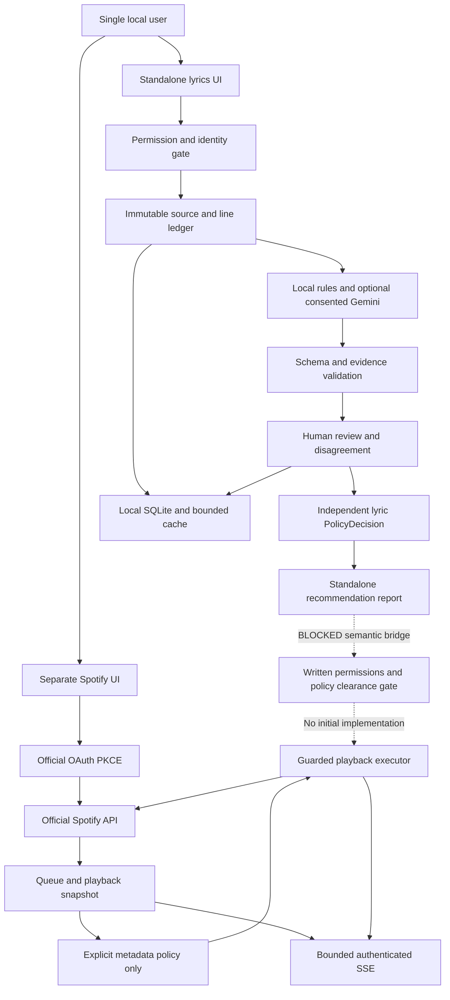
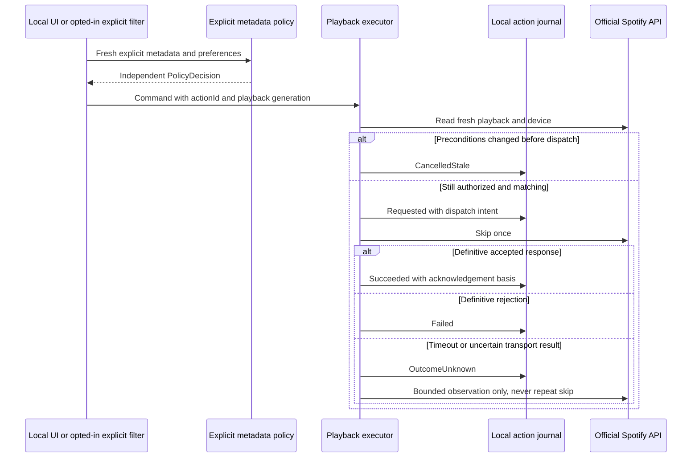

# 04 — Architecture and integration

**Status:** Draft for engineering review  
**Date:** 2026-10-09  
**Document ID:** ARCH  
**Scope:** Alify corporate planning pack; documentation only. No implementation, approval, provider permission, or legal clearance is asserted.

Companion documents: [Data and contracts](05_DATA_AND_CONTRACTS.md), [Infrastructure and operations](06_INFRASTRUCTURE_AND_OPERATIONS.md). Requirement IDs below are the agreed planning identifiers, not claims that an existing PRD file or implementation exists.

## 1. Product boundary and design decisions

| ID | Proposed decision | Requirements |
| --- | --- | --- |
| ARCH-001 | Local-first, one user per installation under one OS account; keep the existing three projects and Razor Pages hosts. No hosted account service, Redis, microservices, or cloud deployment in initial scope. | PRD-001 local single user |
| ARCH-002 | Standalone lyric import and analysis operate without Spotify. Require a recorded permission basis for import, retention, analysis, and any external processing. Scraping is not a prerequisite or default resolver. | PRD-006 permissioned lyric import/resolution |
| ARCH-003 | Analyze topic, speaker stance, and figurative interpretation separately, with verifiable source evidence. The model never emits `ShouldSkip`; interpretation is not playback control. | PRD-007 stance analysis; PRD-008 evidence integrity |
| ARCH-004 | `PolicyDecision` is an independent, versioned local evaluation. User preferences and review can change a recommendation without changing the original analysis. | PRD-009 policy separation; PRD-010 human review |
| ARCH-005 | Spotify lane uses official OAuth and public Web API metadata/playback only. Semantic Spotify integration is **BLOCKED** until written permissions and policy clearance cover the actual proposed data flow and use. | PRD-002 OAuth PKCE/security; PRD-003 queue/playback; PRD-004 explicit filtering; PRD-009 |
| ARCH-006 | Gemini BYOK is optional and off by default, with explicit transfer consent and a user-set budget. No automatic fallback to another model provider. | PRD-011 BYOK consent/budget |
| ARCH-007 | Outcomes, uncertainty, review disagreement, and limitations are visible and keyboard/screen-reader accessible. No claim that a track is morally safe or objectively unsuitable. | PRD-010; PRD-014 release usability/accessibility |

Prohibited initial mechanisms: private Spotify endpoints; Spicetify hooks; Spotify cookies or session extraction; mandatory web scraping; sending Spotify-sourced content/metadata into semantic analysis; a lyric recommendation triggering Spotify playback. A matching song title, user import, user consent, or availability of an API key does not bypass ARCH-005. Spotify official API eligibility, account capabilities, scopes, quotas, and terms still need a release-time review; this document does not grant permission for the official lane either.

## 2. Actual source baseline (inspected, not executed)

Paths in this section are relative to the `Alify` workspace root. Source is the baseline; older architecture prose is not evidence of current approval or deployed infrastructure.

| Actual observation | Inspected source/configuration | Gap versus proposed product |
| --- | --- | --- |
| `Alify.Core`, `Alify.Lyrics`, and `Alify.Spotify` target `net10.0`; web hosts reference Core. Core itself references `SpotifyAPI.Web`. | Each project's `.csproj`; `Directory.Packages.props` | Preserve project structure; introduce provider-neutral contracts without pretending Core is already isolated from Spotify. |
| Lyrics host registers Razor Pages, controllers, HTTP clients, logging, output cache, and Doppler. `/LyricsView` resolves lyrics through `LyricService`. | `Alify.Lyrics/Program.cs`; `Alify.Lyrics/Pages/Lyrics/LyricsView.cshtml.cs` | Permissioned import/resolution and standalone analysis/review workflow are proposed. |
| `LyricService` searches Genius and scrapes the first result with Playwright. Moderation requests broad category booleans and can fall back through Gemini, OpenRouter, and Mistral. Cache uses `lyrics.GetHashCode()`. | `Alify.Lyrics/Features/Lyrics/Services/LyricService.cs`; `PlaywrightLyricsScraper.cs`; `Alify.Core/ApiKeys.cs` | No recording-match gate, stable evidence contract, consent/budget contract, or stance model is established by these paths. Legacy scraping/failover is not an approved initial release dependency. |
| `ArtistLyricService` keeps line counters through blanks but splits on CR and LF separately, trims text, and omits empty mapped entries. `LyricMapping` is mutable. | `Alify.Core/Services/ArtistLyricService.cs`; `Alify.Core/Models/LyricModels.cs` | New immutable source versions and a CRLF-safe line ledger must be introduced alongside the legacy parser. Existing numbering cannot be silently reinterpreted. |
| OAuth stores state/tokens in session, exchanges code with a client secret, and caches an access token for background work. Requested scopes include playlist modification. Logout removes session entries. | `Alify.Spotify/Features/Spotify/Services/SpotifyService.cs`; `Features/Authentication/AuthController.cs`; `Pages/Authentication/callback.cshtml.cs` | PKCE, least privilege, OS credential storage, coordinated refresh, and comprehensive disconnect are planned, not actual. |
| Queue/current playback paths fetch lyrics via lyrics.ovh and can skip `IsFlagged` or Spotify explicit tracks. `CreateTrackFromFullTrackAsync` sets `IsFlagged` from explicit metadata. No new stance-based workflow should be inferred. | `QueueService.cs`, `SpotifyService.cs`, `FreeLyricsProviderService.cs`, `SpotifyRequestCache.cs` in `Alify.Spotify/Features/Spotify/Services/` | Spotify lyric enrichment must be detached in a staged change; metadata filtering must not depend on lyrics or model output. |
| Monitor is a hosted polling service. SSE writes/flushing traverse clients directly; `/SpotifyEvents` sets wildcard CORS. | `SpotifyPlaybackMonitorService.cs`; `SseService.cs`; `Alify.Spotify/Pages/Spotify/SpotifyEvents.cshtml.cs` | Bounded independent delivery, authenticated subscription, reconnect semantics, and cancellation are planned. |
| Playback DTOs embed `FullTrack`, lyrics, mappings, and `IsFlagged`; no inspected persistent database schema backs them. | `Alify.Spotify/SpotifyModels.cs` | SQLite schema and new public DTOs in DATA are proposals. |

Security release blocker: `Alify.Spotify/Properties/launchSettings.json` contains client-secret material. Do not copy values into this pack or artifacts. Treat it as exposed pending owner investigation and rotation; see OPS-RB-001. This documentation task neither rotates credentials nor changes configuration.

## 3. Proposed architecture (not implemented)

**ARCH-008 — Ownership:** Core receives additive neutral domain records, validation, and deterministic policy rules; Lyrics owns permissioned imports, analysis orchestration, and review; Spotify owns OAuth, official metadata, polling, and guarded playback. SQLite access and credential adapters are local infrastructure abstractions, not new services or projects by implication. Each host has its own protected browser session and same-origin SSE; only the credential adapter accesses secrets. Do not pass raw provider SDK DTOs across the new boundary. Two local processes are application hosts, not a microservice deployment. [PRD-001, PRD-009, PRD-012]

**ARCH-009 — Separation enforcement:** Initial Spotify registration must not resolve an analyzer, lyric resolver, or semantic policy adapter. New Spotify DTOs/events contain no lyric text, evidence, or semantic conclusions. Contract tests and denied-network tests prove there is no Spotify-to-analysis traffic. Any future bridge requires a separately reviewed data-flow design, written rights/terms assessment with scope and expiry, minimization controls, explicit UI consent, and an independently disableable feature. No hidden toggle enables it before clearance. [PRD-009, PRD-011]

### Conceptual ports

These names describe future interfaces; none is asserted to exist. All asynchronous operations accept cancellation and return typed results rather than null as a combined error/absence signal.

| Proposed port | Responsibility and invariants | Requirements |
| --- | --- | --- |
| `IPermissionedLyricResolver.ResolveAsync(request, cancellationToken)` | Validate permission scope and recording match; return exact `LyricResolution` status and provenance. User file/paste is the initial source; a provider requires documented rights. | PRD-006, PRD-013 |
| `ILyricAnalyzer.AnalyzeAsync(sourceVersion, options, cancellationToken)` | Produce stance/figurative findings and evidence references, never a skip directive; Gemini requires an authorized transfer and reservation. | PRD-007, PRD-008, PRD-011 |
| `IEvidenceValidator.Validate(result, sourceVersion)` | Verify line membership, exact excerpts, ranges, hashes, schema, and version references before persistence. | PRD-008 |
| `IReviewRepository.AppendAsync(review, expectedRevision, cancellationToken)` | Preserve original result, reviewer rationale, disagreement, and optimistic concurrency; no destructive model-result edit. | PRD-010 |
| `IPolicyEvaluator.Evaluate(input, preferences, reviewRevision)` | Deterministic `PolicyDecision`: `Allow`, `RecommendSkip`, or `Abstain`; no network or playback side effects. Lyrics and explicit-only Spotify contexts cannot be mixed. | PRD-004, PRD-009 |
| `ISpotifyGateway.ReadSnapshotAsync(...)` | Official API only; minimal metadata and freshness/device/account generation. No lyrics. | PRD-002, PRD-003 |
| `IPlaybackExecutor.RequestAsync(command, cancellationToken)` | Independent action record, fresh preconditions, at most one dispatch per local action; uncertainty is not success. | PRD-003, PRD-004 |
| `ILocalEventStream.SubscribeAsync(...)` | Bounded per-client event channel and replay/reset protocol, not direct fan-out writes. | PRD-005 |
| `ICredentialStore` / `ILocalDataStore` | OS-backed secrets / SQLite respectively; deletion and unavailable-store behavior are explicit. | PRD-001, PRD-002, PRD-012 |

## 4. Standalone interpretation and review

**ARCH-010 — Analysis sequence:** permission check → recording-match resolution → freeze source version → parse immutable line ledger → local rules/optional authorized Gemini → strict output/evidence validation → persist analysis → render evidence and limitations → append human review → independently evaluate policy. No lyric analysis is performed for `Mismatch`, `NotFound`, or `ProviderUnavailable`. `Instrumental` needs affirmative provenance, not empty lyrics. Cancellation is a job lifecycle state, not another analysis-result status. [PRD-006–PRD-011, PRD-013]

The canonical stance enum is exactly `Endorsed`, `Mentioned`, `Rejected`, `Ambiguous`: endorsement/glorification, mention/description without endorsement, criticism/rejection, and unresolved stance respectively. The independent expression enum is exactly `Literal`, `Figurative`, `Unknown`. Optional expression subtype (for example, metaphor, hyperbole, or satire) and quoted narrator/character attribution are metadata, not additional enum values. Quoted speech does not itself establish endorsement; unresolved stance uses `Ambiguous`. Mentions or keywords alone do not prove endorsement. Confidence is an uncalibrated estimate unless validated otherwise; unsupported language and insufficient context remain visible. Local rules may report only bounded, explainable observations and must abstain from interpretive claims they cannot support. Ship a declared supported-language/rules scope rather than promising an unbuilt local model.

**ARCH-011 — Disagreement:** UI displays source lines, surrounding context, model/rules version, and uncertainty. The user can agree, disagree, request context, or mark unresolved, with a reason and optionally alternate evidence. An append-only review supersedes an earlier review by reference; it never erases the analysis. Policy records exactly which review revision it used. Unresolved or conflicting evidence leads to `Abstain` by default. Recommendation exports remain standalone and include limitations. [PRD-007, PRD-008, PRD-009, PRD-010, PRD-014]

## 5. Spotify control, race conditions, and action uncertainty

**ARCH-012 — Playback state:** A queue is a dated observation, not a guaranteed future order. No active device, unsupported item, missing explicit flag, stale snapshot, denied capability, or revoked authorization is represented as a fabricated safe track. User starts monitoring explicitly; restart/disconnect does not silently resume automatic filtering. Explicit-only filtering requires opt-in and fresh official metadata. [PRD-003, PRD-004, PRD-012]

**ARCH-013 — Action guard:** Serialize commands per installation/device context; compare account generation, device, snapshot freshness, current recording, and playback generation immediately before dispatch. Generation distinguishes replay of the same recording from the earlier occurrence. Proposed freshness maximum is two seconds at dispatch. Spotify does not provide a guaranteed compare-and-skip transaction: document the remaining race, allow user pause/disable, and never claim exactly-once remote execution. [PRD-003, PRD-004]

The exact action vocabulary is `Requested`, `Succeeded`, `Failed`, `OutcomeUnknown`, `CancelledStale`. A definitive provider acknowledgement may establish `Succeeded` for command acceptance; separately record whether the playback effect was observed. Reports and UI must label command acceptance separately from observed playback effect; `Succeeded` alone must never be presented as an observed skip. Track change alone is not proof that Alify caused it. A timeout after possible dispatch, crash with unresolved dispatch intent, or ambiguous response becomes `OutcomeUnknown`. Never automatically retry a skip, including in HTTP middleware or SDK retry policies. A repeat click with the same action ID returns the journaled result; a new deliberate user action requires a fresh snapshot and confirmation of the unresolved prior action. Disconnect cancels undispatched work; already dispatched work can remain unknown. [PRD-003, PRD-012]

## 6. Loopback authentication and event delivery

**ARCH-014 — Local security:** Loopback binding is necessary but not authentication. Restrict listeners to explicit IPv4/IPv6 loopback addresses, validate `Host` against exact listener origins to resist DNS rebinding, and deny wildcard CORS. Use a launcher-generated high-entropy, single-use bootstrap exchange to establish a server-side session; never place durable capabilities or provider tokens in URLs, localStorage, or SSE payloads. Pin exact allowed browser origins, apply CSRF tokens to mutations, and protect GET status/SSE with the local session. For cross-origin browser requests deny unexpected/missing origins as appropriate; the OAuth callback is a narrow exception protected by state, not a general CORS exemption. Use `HttpOnly`, host-only, `SameSite` cookies and `Secure` for HTTPS; plain HTTP loopback needs documented compensating controls and never a LAN fallback. Escape lyric content and evidence as text; CSP forbids arbitrary inline script and remote script dependencies. OS-account compromise is outside the local-session threat boundary. [PRD-001, PRD-002, PRD-005]

**ARCH-015 — OAuth plan:** Official authorization-code PKCE with S256; cryptographically random verifier and state bound to the initiating local session, short-lived (proposed five minutes), single-use, stored only server-side. Use an exact registered loopback redirect; verify Spotify's then-current port and redirect rules rather than assuming arbitrary dynamic ports work. Bind before opening the system browser; reject unsolicited, expired, replayed, or mismatched callbacks. A packaged public client cannot protect a client secret and must not distribute one. Start with read-current/read-playback scopes; request modify-playback only for opted-in controls. Do not request playlist-modification scopes without a separate requirement. Serialize refresh, securely persist rotation, invalidate stale auth generations, and have background jobs use the credential broker rather than `HttpContext`. [PRD-002, PRD-012]

**ARCH-016 — SSE plan:** Same-origin authenticated streams; one bounded channel/writer per client (proposed 64 pending events, maximum four clients per installation), maximum event size 16 KiB, 15-second heartbeats, five-second write deadline. Coalesce superseded playback snapshots; never silently drop action/review outcomes. On non-coalescible overflow close that client with a resync indication where possible; authoritative journal remains queryable. A slow client must not block monitoring, commands, or other clients. Disable response/output caching, buffering, and compression on SSE. IDs include process epoch and sequence; retain at most 256 replay events/60 seconds in memory. Invalid/expired `Last-Event-ID` gets `reset` plus current snapshot and journal cursor. Client retries stream connection with bounded jitter, never playback commands. Disconnect/shutdown cancels writers and releases subscriptions. [PRD-005, PRD-003, PRD-014]

## 7. Additive migration and engineering gates

Every stage below is **proposed**. Preserve current source and endpoint paths; do not silently reinterpret legacy booleans as stance/evidence or leave unsafe behavior enabled merely for compatibility. A compatibility adapter may return an explicit unavailable/disabled explanation where a blocked legacy behavior cannot safely be preserved. Version new contracts as defined in DATA-010.

| Stage / ID | Planned work | Exit evidence |
| --- | --- | --- |
| ARCH-M0 — Baseline | Capture existing routes/DTO behavior with offline fixtures; inventory credentials, outbound calls, DI ownership, and cancellation. Reconcile stable SDK under OPS-002. | Reviewed inventory; legacy route tests; exposed-secret remediation plan. |
| ARCH-M1 — Standalone foundation | Add permissioned import, immutable versioned source/identity, SQLite, evidence validator, local security, deletion, and no-network default. Keep old parser separately versioned. | CRLF/LF/blank/timestamp tests; import permissions; DB migration/restore; no scraping or Doppler startup requirement. |
| ARCH-M2 — Interpretation/review | Implement bounded local rules, independent policy, review history, optional Gemini consent/budget, `/api/v1` contracts. | Invalid evidence rejected; stance/figurative contrast fixtures; disagreement/revision tests; no key/no network workflow. |
| ARCH-M3 — Official Spotify isolation | PKCE/credential broker, metadata-only queue/playback, explicit-only opt-in, action journal, bounded SSE; detach lyric enrichment without deleting legacy source. | Denied semantic bridge; no duplicate skip under timeout/crash; OAuth replay/CSRF/rebinding tests; disconnect clears background authorization. |
| ARCH-M4 — Release readiness | Packaged local launch, signed/verified artifacts where supported, accessibility, restore/rollback, local diagnostics. | OPS release checklist and proposed SLO measurements; no unmet security/policy gates. |
| ARCH-M5 — Conditional semantic bridge | **BLOCKED**; not a committed initial deliverable. Design only after scoped written permissions and policy clearance. | Separate engineering/security/policy review with attributable records, expiry, revocation, data-flow tests; no approval implied here. |

### Requirement traceability and acceptance anchors

| Requirement | Design anchors | Planned acceptance check |
| --- | --- | --- |
| PRD-001 local single user | ARCH-001, ARCH-008, ARCH-014; OPS-003 | Standalone launch/import/review with outbound network denied; no account service. |
| PRD-002 OAuth PKCE/security | ARCH-005, ARCH-014, ARCH-015; OPS-004 | PKCE, replay/state/CSRF/Host rejection, no shipped secret, locked credential-store test. |
| PRD-003 queue/playback | ARCH-012, ARCH-013; DATA-007 | Stale/repeated/unknown command fixtures; queue shown with freshness, not promised order. |
| PRD-004 explicit filtering | ARCH-005, ARCH-012; DATA-006 | Official explicit flag only; missing flag abstains; opt-in and disabled-state tests. |
| PRD-005 SSE | ARCH-016; DATA-011 | Slow reader, overflow, resume/reset, shutdown; action loss recoverable from journal. |
| PRD-006 permissioned lyric import/resolution | ARCH-002, ARCH-010; DATA-002 | Permission failure, mismatch, instrumental, unavailable tested separately. |
| PRD-007 stance analysis | ARCH-003, ARCH-010; DATA-004 | `Mentioned` versus `Endorsed` versus `Rejected` versus `Ambiguous`, and `Literal` versus `Figurative` versus `Unknown` contrast cases. |
| PRD-008 evidence integrity | ARCH-003, ARCH-010; DATA-003 | Exact excerpts, immutable version/hash, original line IDs; hallucinated evidence rejected. |
| PRD-009 policy separation | ARCH-004, ARCH-009; DATA-006 | Preference edit changes policy only; semantic Spotify bridge denied. |
| PRD-010 human review | ARCH-011; DATA-005 | Disagreement preserved, stale review conflicts, unresolved review causes abstention. |
| PRD-011 BYOK consent/budget | ARCH-006; DATA-009; OPS-005 | No consent/key/budget means no transfer; reservations prevent concurrent overspend. |
| PRD-012 disconnect/deletion | ARCH-013, ARCH-015; DATA-013; OPS-RB-003 | Background work stopped, secrets removed, source descendants deleted, uncertainty retained honestly. |
| PRD-013 recording identity/cache | ARCH-010; DATA-001, DATA-008 | Clean/explicit/live/remaster not conflated; cache invalidates on all version changes. |
| PRD-014 release usability/accessibility | ARCH-007, ARCH-016; OPS-008 | Packaged first-run, offline help, keyboard/screen-reader review and unknown-action presentation. |

## 8. Open decisions and review owners

Proposed engineering owners: application lead (staged adapters/contracts), security reviewer (loopback, PKCE, credential incident), data lead (immutable ledger/migrations), product/review lead (stance taxonomy and accessible uncertainty), release owner (packaging/SLO evidence), and policy/rights reviewer (permission scopes and any future bridge). These are roles to assign, not recorded approvals.

Before implementation freeze: select initial supported languages and local-rule scope; verify official Spotify capabilities and registered redirect requirements; choose supported OS/RIDs and credential adapters; define import/export permission wording and provider processing rights; select an allowed Gemini model/version and price source. No runtime, external API, network, build, or test execution was performed to validate this design.
